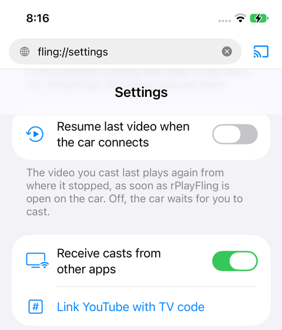

# Tutorial: cast from the YouTube app

You can send a video from the YouTube app itself to the car, with YouTube's own Cast button, and the YouTube app is then the remote: queue, next, seek, pause. Your subscriptions, playlists and history are right there.

It needs a one-time link between the YouTube app and rPlayFling, with a TV code. After that it works everywhere, including in the car on cellular with no Wi-Fi.

Before you start: rPlayFling must be **open on the car screen** whenever you cast this way. The YouTube app lists "rPlayFling" only while the car is connected.

---

## Link once: the TV code

### 1. Get a code from rPlayFling

On the phone, open rPlayFling, tap the ••• menu at the bottom right, then **Settings**. Scroll to the section with **Receive casts from other apps**, and tap **Link YouTube with TV code**.

A 12-digit code appears under the row.

<!--  -->

### 2. Enter the code in the YouTube app

In the YouTube app, play any video and tap the **Cast** icon at the top of the player. In the list of devices, tap **Link with TV code** (on some versions it is under **+ Add a device**).

<!--  -->

Type the twelve digits, then tap Link. YouTube's code field does not take a paste.

<!--  -->

The other way to the same screen: in the YouTube app, your profile picture, Settings, **Watch on TV**, Enter TV code.

### 3. Done

"rPlayFling" is now a device in the YouTube app's Cast list, for good. The link survives app updates and reinstalls. A code is a one-time ticket: if you tap Link YouTube with TV code again later, you get a new code, and entering it links the same car again; YouTube keeps one "rPlayFling" entry.

---

## Cast

1. Connect the phone to the car and open **rPlayFling on the car screen**.
2. In the YouTube app, play a video and tap the **Cast** icon.
3. Tap **rPlayFling**.

<!--  -->

The video plays on the car, on rPlayFling's Now tab, in HD. The YouTube app shows "Playing on rPlayFling" with the player controls: use them as the remote. Queue up more videos, skip, seek, pause.

<!--  -->

**Stop.** Tap the Cast icon in the YouTube app and Stop casting, or stop on the car bar. Either way both ends stop.

**Switching apps.** If you then cast something from rPlayFling's own browser, the car switches to it, and the YouTube app shows that as the video now playing on rPlayFling. You stay connected and can keep using the YouTube app as the remote.

---

## Notes

- **Two "rPlayFling" entries.** On the same Wi-Fi the YouTube app also finds rPlayFling by itself, so you may see "rPlayFling" twice: once found on the network, once from the TV code. Both are the same car; use either.
- **Paid films and rentals** are copy-protected and cannot be played on the car. The car says "Can't play this video. Try another one." Regular videos play.
- **Unlink.** rPlayFling's Settings, Unlink YouTube TV code, forgets the link on the phone. YouTube keeps its own "rPlayFling" entry until you delete it there, under Settings, Watch on TV.
- **"rPlayFling" is missing from the list.** rPlayFling is not open on the car. Open it there, then tap the Cast icon again.

More in the [user guide](user-guide.md), and in [Cast a YouTube video to the car](cast-from-youtube.md) for the way that needs no link: YouTube inside rPlayFling's own browser.
