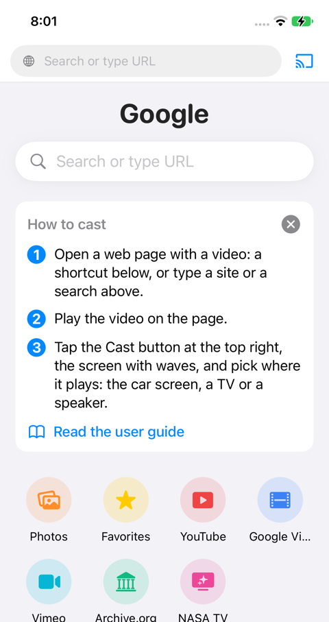
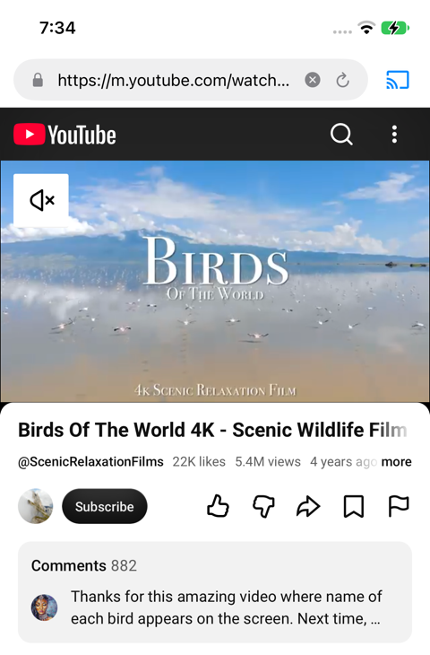
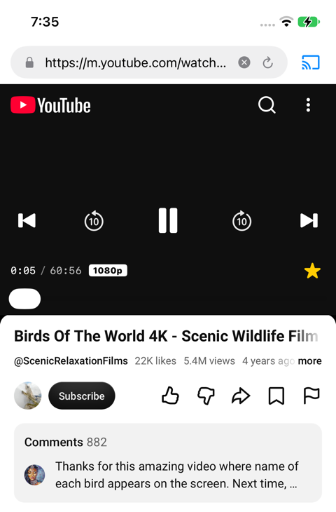

# Tutorial: cast a YouTube video to the car

Five minutes, parked. There are two ways. The first needs nothing set up: it is the one to try first.

Before either: plug the phone into the car (or connect wirelessly), and open **rPlayFling on the car screen**. Until rPlayFling is open on the car, the Cast menu's "Car Screen" entry is greyed out and says "Open rPlayFling in CarPlay".

---

## Way 1: inside rPlayFling

rPlayFling is a web browser. You open YouTube's web page in it, play a video, and send it to the car.

### 1. Tap the YouTube tile

Open rPlayFling on the phone. The start page has a row of tiles. Tap **YouTube**, the first one after Photos and Favorites.

(Tiles are bookmarks: the ••• menu, Add to Bookmarks, puts any site there.)

### 2. Find a video and play it

YouTube's mobile site opens inside rPlayFling. Search, or pick a video from the page, and tap it so it plays, as you would in Safari. Sign in if you want your own subscriptions and history; rPlayFling keeps the login.

### 3. Tap Cast, then Car Screen

Tap the **Cast** button at the top right of rPlayFling, the screen with waves next to the address bar. A menu opens, with **Car Screen** at the top, then the TVs and speakers rPlayFling found on the Wi-Fi. Tap **Car Screen**.

### 4. Watch it on the car

The video plays on the car, on rPlayFling's **Now** tab, in HD where YouTube offers it. On the phone:

- A remote bar appears above the page: play and pause, seek, previous and next, a star for Favorites, and the quality (such as 1080p).
- The page's own player pauses, and the phone says playback is paused to save battery. The sound comes from the car.
- The Cast button turns green.

The video often starts at 360p and moves up to 1080p a few seconds in. That is normal.

### Next video, next time, stop

- **Another video.** Open it on the page, in the same tab or a new one. The car switches.
- **Next and previous.** The remote bar's next button, the car's next and previous buttons, and the steering wheel's track buttons all play the next video from the page's list.
- **Next time.** With Settings, Resume last video when the car connects, on, the last video starts again from where it stopped as soon as rPlayFling is open on the car.
- **Stop.** Tap the green Cast button, or Stop on the car bar.
- Keep rPlayFling running in the background; the phone may lock. Do not swipe the app away in the app switcher: that ends the cast.

### If it does not work

- **"Car Screen" is greyed out.** rPlayFling is not open on the car yet. Open it there, then tap Cast again.
- **The car shows "Can't play this video. Try another one."** Paid films and rentals on YouTube are copy-protected and cannot be cast by any app but YouTube's own. Regular videos play.
- **The phone page plays in 360p.** YouTube's mobile page always does on the phone; the car gets HD. Look at the quality label on the remote bar, not at the page.
- **Nothing on the car, and the Cast button is green.** Tap the car's Now tab. If the car was asleep, unplug and plug the phone again.

---

## Way 2: from the YouTube app

You can also cast from the YouTube app itself, with YouTube's own Cast button, and the YouTube app is then the remote: queue, next, seek, pause. It needs a one-time link.

### Link once, with a TV code

1. In rPlayFling on the phone, open the ••• menu, then **Settings**, and tap **Link YouTube with TV code**. A 12-digit code appears.
2. In the YouTube app, tap the Cast icon on any video, then **+ Add a device** (or YouTube's Settings, Watch on TV, Enter TV code), and type the twelve digits. YouTube's field does not take a paste.
3. From now on, "rPlayFling" is in the YouTube app's Cast menu whenever rPlayFling is open on the car. It works on cellular in the car too; no Wi-Fi needed.

### Cast

1. Open rPlayFling on the car screen.
2. In the YouTube app, play a video, tap the Cast icon, and pick **rPlayFling**.
3. The video plays on the car. The YouTube app shows the player controls; use them as the remote. Switch rPlayFling off the car or stop casting in the YouTube app, and the car stops.

On the same Wi-Fi you may see "rPlayFling" twice in YouTube's Cast menu, once found on the network and once from the code. Both are the same car.

---

More in the [user guide](user-guide.md): the car screen, the Web tab, full screen, knob cars, your own videos, TVs.
