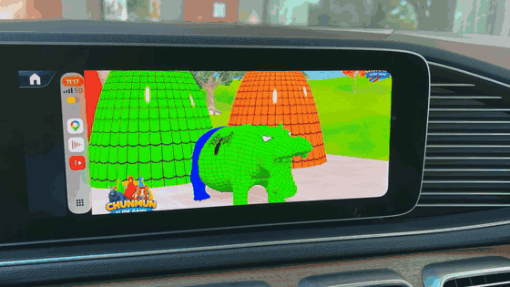

# Tutorial: fill the whole car screen

A video cast to the car plays on rPlayFling's **Now** tab. Most car screens are wider than a video, so the picture comes with black bars on the sides, or, on a tall screen, above and below. One button on the car bar removes them. The second part of this page is about videos playing on the car's Web tab, which is a different case.

---

## Part 1: a cast video, with the picture-size button

### Watch it done

Fourteen seconds in a car: the video playing with bars, a tap on the picture-size button, the picture filling the screen.

The same clip in full quality: [car-video-size.mp4](videos/car-video-size.mp4) (3 MB).

### Step by step

1. **Cast a video** to the car (see [Cast a YouTube video to the car](cast-from-youtube.md)). It plays on the Now tab.
2. **Tap the picture** to show the control bar. It hides again on its own after a few seconds.
3. **Tap the picture-size button** on the bar: the rectangle with two arrows, to the right of the star. Each tap steps to the next size, and the bar shows its name for a moment:
   - **Fit**: the whole picture, with bars. The default.
   - **Fill**: the picture is enlarged to cover the screen; a little is cropped at the edges.
   - **Stretch**: the picture is pulled to the screen's shape with no cropping; it looks slightly wider.
4. Stop at the one you like. rPlayFling remembers it for every video after this.

The same choice is in rPlayFling's Settings on the phone, under **Car video size**. On a car with a small screen, that is easier than the bar's button.

With a knob or commander: turn until the size button on the bar is highlighted, then press.

---

## Part 2: a video on the car's Web tab

The **Web** tab is a browser on the car screen itself. A video playing there sits inside the web page, with the site's layout around it. To give it the whole screen:

### 1. Start the video

Tap the video on the car page so it plays. (You can also start it from the phone: the car's Web tab shows the phone's current tab.)

### 2. Tap the Full-screen page button

On the car toolbar, tap **Full-screen page**, the ⤢ arrows icon. rPlayFling presses the site's own full-screen button for you. The picture fills the screen and the toolbar goes away.

### 3. Controls in full screen

Tap the picture: the site's own controls appear. Close, back and forward 10 seconds, pause, the seek bar.

### 4. Leaving full screen

- Tap the small button at the top right of the screen, or the site's own exit button in the video's controls.
- With a knob or commander: turn up past the top of the page, or press the knob while nothing is highlighted.

The toolbar comes back.

If the page has no video, the same button just hides the toolbar to give the page more room.

---

More in the [user guide](user-guide.md): the car screen, the Web tab, knob cars, casting from the YouTube app.
