# rPlayFling user guide

rPlayFling plays web videos, your own videos and photos, and casts from other apps on your car's CarPlay screen, and on TVs: Apple TV and AirPlay TVs, Chromecast and Google TV, and DLNA TVs and boxes. The car is what rPlayFling was built for, so this guide focuses on CarPlay; casting to a TV works the same way from the same Cast button, and the differences are in [Casting to a TV](#11-casting-to-a-tv). Everything on the car screen works with a touch screen and just as well with a rotary knob or commander, as in a Mazda or BMW; see [Cars with a knob or commander](#6-cars-with-a-knob-or-commander). The guide walks through every feature in the order you will meet them. It is written for the TestFlight beta, 2.1 (58) and later.

Contents

1. [Before you start](#1-before-you-start)
2. [Cast a web video to the car](#2-cast-a-web-video-to-the-car)
3. [The car screen](#3-the-car-screen)
4. [The Web tab: browse on the car screen](#4-the-web-tab-browse-on-the-car-screen)
5. [Full screen on the car](#5-full-screen-on-the-car)
6. [Cars with a knob or commander](#6-cars-with-a-knob-or-commander)
7. [Cast from the YouTube app](#7-cast-from-the-youtube-app)
8. [Cast from other apps: DLNA and FCast](#8-cast-from-other-apps-dlna-and-fcast)
9. [Your own videos and photos](#9-your-own-videos-and-photos)
10. [Cast the phone's screen](#10-cast-the-phones-screen)
11. [Casting to a TV](#11-casting-to-a-tv)
12. [Favorites, Recent and bookmarks](#12-favorites-recent-and-bookmarks)
13. [Settings, one by one](#13-settings-one-by-one)
14. [Driving](#14-driving)
15. [Troubleshooting](#15-troubleshooting)
16. [What rPlayFling cannot do](#16-what-rplayfling-cannot-do)
17. [Developer options](#17-developer-options)
18. [Sending a log with a bug report](#18-sending-a-log-with-a-bug-report)

---

## 1. Before you start

**Install.** Join the beta at https://testflight.apple.com/join/rncgthyN and install rPlayFling from the TestFlight app. You need an iPhone with iOS 18 or later and a car or head unit with CarPlay.

**Allow Local Network.** The first time you cast, iOS asks whether rPlayFling may find devices on the local network. Allow it. Without it the Cast menu finds no TVs and the car web page cannot load. If you tapped Don't Allow, turn it on later under iOS Settings, Privacy & Security, Local Network.

**Open rPlayFling on the car.** Connect the phone to the car, then tap the rPlayFling icon on the CarPlay home screen. The car shows rPlayFling's own screen with its tabs. Casting to the car works only while rPlayFling is open on the car screen; if the car shows another app, the video is cast but the car does not display it until you open rPlayFling there.

**Park.** Video on the car screen is for a parked car. While the car moves, the picture is hidden and the sound keeps playing. See [Driving](#14-driving).

---

## 2. Cast a web video to the car

rPlayFling is a web browser on the phone. Any video that plays in it can go to the car.

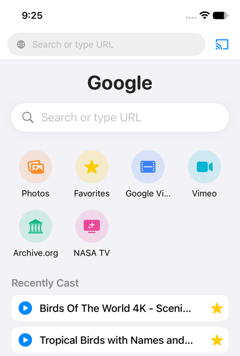

1. **Find a video.** Type a site or a search in the address bar at the top. For YouTube, type `youtube.com`. The start page has a few shortcuts (Photos, Favorites, Google Video, Vimeo, Archive.org, NASA TV) and the sites you bookmark. YouTube has no shortcut by design, but you can bookmark it: open youtube.com, tap the ••• menu, then Add to Bookmarks.
2. **Start playing it** on the page, as you would in Safari.
3. **Tap the Cast button** (the screen-with-waves icon at the top right) and pick **Car Screen**. On the car, the picture appears on the Now tab.

What you will see on the phone:

- A remote bar appears above the page: play and pause, seek, previous and next, a star for Favorites, and a quality label such as 1080p.
- The page's own player is paused. The phone says "Phone playback is paused to save battery & bandwidth". The sound comes from the car.
- The Cast button turns green. Tap it again to stop casting, or pick Stop Casting from its menu.

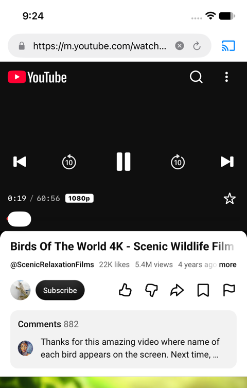

**Quality.** The cast is 1080p where the site offers it, 720p or 360p otherwise, as set under Settings, Cast Quality. A video often starts at 360p and moves up to 1080p a few seconds in, when the site releases the HD stream. That is normal. The quality label on the remote bar shows what is on the car right now. Do not judge the cast by the phone page's own quality menu: YouTube's mobile page plays 360p on the phone while the car gets HD.

**Change the video.** While casting, open another video on the page, in the same tab or another. The car switches to it. In HD the switch takes a few seconds longer than at 360p.

**Next and previous.** On a YouTube page the remote bar's next button plays the next video from the page's list, and so do the car's next and previous buttons and the steering wheel's track buttons.

**Next time in the car.** With Settings, Resume last video when the car connects, on, the video you cast last starts again from where it stopped as soon as rPlayFling is open on the car; nothing to tap.

**Keep rPlayFling running.** It may go to the background and the phone may lock; the cast continues. Do not swipe the app away in the app switcher: that ends the cast.

**Stop.** Tap the green Cast button, or Stop on the car bar. The car goes back to the list.

---

## 3. The car screen

rPlayFling's car screen has tabs along the top and, while something plays, a bar along the bottom. Every control on it is reachable by touch or by the car's knob.

**Tabs**

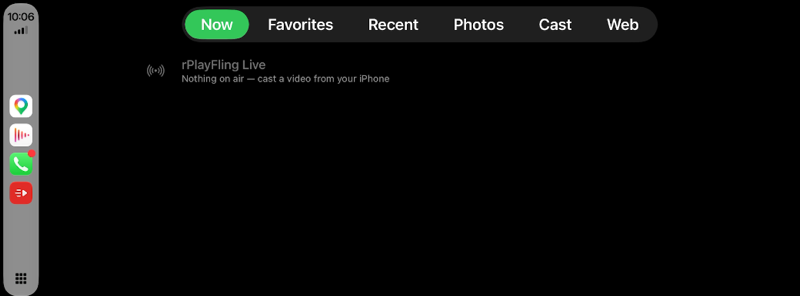

- **Now**: the video on air. With nothing on air it is a hint to cast from the phone.
- **Favorites**: the videos you starred. Tap one to play it again without touching the phone.
- **Recent**: the last videos you cast. Tap to play again.
- **Photos**: your photo library and a slideshow, and videos you imported. See [Your own videos and photos](#9-your-own-videos-and-photos).
- **Cast**: the ways other things reach this screen, with a check mark when one is ready: the phone's screen through Control Center's screen recording, and DLNA apps casting to "rPlayFling".
- **Web**: a browser on the car screen. See [The Web tab](#4-the-web-tab-browse-on-the-car-screen).

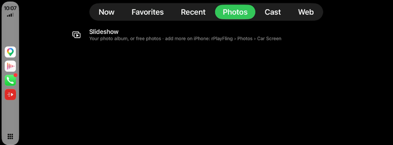

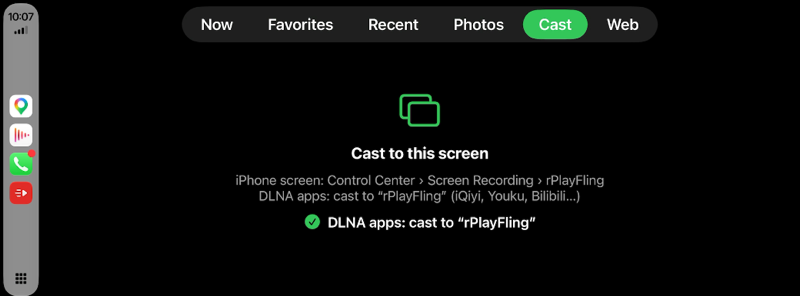

**The video bar**, along the bottom of the picture, with the video playing on above it:

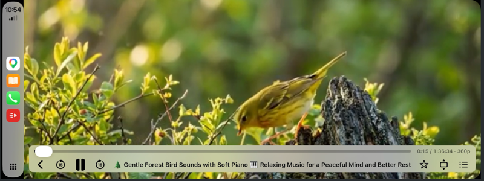

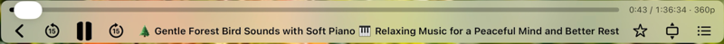

- The top row is the position: the time played, the length, and the quality on the car right now (here still 360p, before the HD stream arrived). Drag it, or turn the knob on it.
- Below: a back arrow that returns to what you were looking at before the video; 15 seconds back; pause and play; 15 seconds forward; the video's title; the star for Favorites; the picture size (Fit, Fill, Stretch); and the lists button, which opens the tabs over the video without stopping it. For your own videos and photos, previous and next are there too.

It fades after a few seconds; tap the picture or move the knob to bring it back.

**Picture size.** Fit shows the whole picture with bars, Fill crops to fill the screen, Stretch fills without cropping. The same choice is under Settings, Car video size, which is easier than the small button on some screens.

**Sidebar.** On cars with CarPlay's sidebar the picture sits beside it. Settings, Video under CarPlay sidebar, puts the picture under the whole screen with the sidebar drawn over its edge.

**Toolbar look.** Settings, Car toolbar look: light or dark, or the car's own day and night look.

---

## 4. The Web tab: browse on the car screen

The Web tab is a browser on the car itself, for a parked car. It opens on the page you last cast from, or on your bookmarks.

**Toolbar**, at the top of the page: Close, Back, Home, Reload, Full-screen page (the arrows icon ⤢) and More. More holds the address field with your bookmarks, the languages button, the car keyboard and voice input.

**Typing.** The address field opens a keyboard on the car screen, in English or Chinese pinyin (the 中/英 key switches). The microphone key takes voice input. You can also type on the phone: while the field on the car is open, the phone shows a box, and what you type there goes into the field on the car.

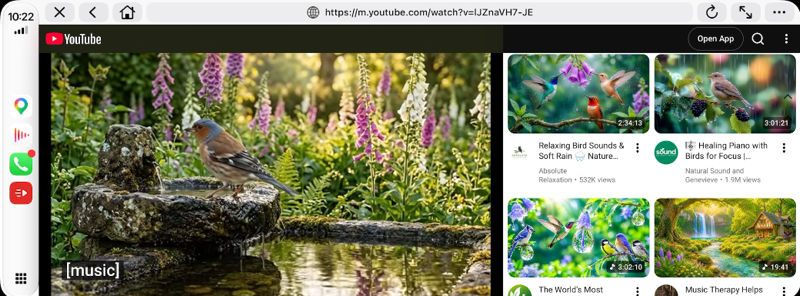

**Playing a video on the Web tab.** Tap a video on the page and it plays on the car in the page's own player, with the page's own controls. This is different from casting: the page itself is on the car. Tap the Close button to go back to the tabs.

**Show a page on the car from the phone.** On the phone, the ••• menu has Show Page on Car. It opens the page you are on in the car's Web tab.

---

## 5. Full screen on the car

A video playing on the Web tab sits inside the page, with the site's layout around it. To give it the whole car screen:

1. Start the video on the car page, or on the phone (tap the video).
2. Tap the **Full-screen page** button on the car toolbar, the ⤢ arrows icon.

rPlayFling presses the site's own full-screen button for you, and the picture fills the screen; the toolbar goes away.

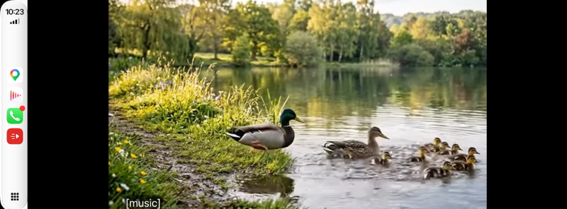

A tap on the picture shows the site's own controls: close, back and forward 10 seconds, pause, the seek bar.

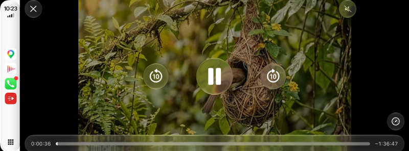

 If the page has no video, the same button just hides the toolbar to give the page more room.

**Leaving full screen.** Tap the small button at the top right of the screen, or tap the site's own exit button in the video's controls. With a knob, turn up past the top of the page, or press the knob while nothing is highlighted. The toolbar comes back.

Full screen is for the Web tab. A video you cast from the phone with Cast, Car Screen is already full screen on the Now tab.

---

## 6. Cars with a knob or commander

On cars with no touch screen (Mazda, BMW and others) rPlayFling is driven with the rotary knob.

**Lists and bars.** Turn to move the highlight, press to select. Tilt the knob to jump in that direction. The video bar's position slider takes the knob: turn to scrub, press to set.

**The Web tab.** The knob moves a blue highlight over the page's links, buttons and videos: turn for the next and previous one in reading order, tilt for the nearest one in that direction. Press to open the highlighted item. The page scrolls to keep the highlight in view. Turning up past the top of the page moves the highlight to the toolbar.

**Playing a video with the knob.** Highlight the video and press: it plays. The player's own controls (play, -10 s, +10 s, full screen, the seek slider, settings) are reachable with turns once the video has started; the player shows them when the highlight lands on one. Press full screen in the controls, or use the toolbar's ⤢ button.

**Out of full screen.** Turn up past the top of the page, or press the knob while nothing is highlighted. From 2.1 (58).

---

## 7. Cast from the YouTube app

You can send a video from the YouTube app itself to the car, with YouTube's own Cast button. The video plays on the car in HD, and the YouTube app is its remote: queue, next, seek, pause.

**Link once with a TV code**, so it works everywhere, including in the car on cellular with no Wi-Fi:

1. On the phone, open rPlayFling's Settings (the ••• menu, Settings) and tap **Link YouTube with TV code**. A 12-digit code appears, with a Copy button.
2. In the YouTube app, tap the Cast icon on any video, then **+ Add a device** (or go to YouTube's Settings, Watch on TV, Enter TV code), and enter the code. Type the twelve digits by hand: YouTube's code field does not take a paste, so the Copy button is only for keeping the code somewhere.
3. "rPlayFling" is now in YouTube's Cast menu whenever rPlayFling is open on the car.

Tapping Link YouTube with TV code again gives a new code; a code is a one-time ticket. It links the same screen again, so YouTube keeps one "rPlayFling" entry.

**On Wi-Fi without a code.** When the phone and rPlayFling are on the same Wi-Fi, the YouTube app finds "rPlayFling" by itself while rPlayFling is open on the car. You may then see "rPlayFling" twice in YouTube's Cast menu, once found on the network and once from the TV code. Both are the same car; use either.

**Stop.** Stop casting in the YouTube app, and the car stops too.

**Unlink.** Settings, Unlink YouTube TV code, forgets the link on the phone. YouTube keeps its own "rPlayFling" entry until you delete it there, under YouTube's Settings, Watch on TV.

The link survives app updates and reinstalls.

---

## 8. Cast from other apps: DLNA and FCast

**DLNA.** Apps that cast to TVs over DLNA (iQiyi, Youku, Bilibili and many others) list "rPlayFling" in their cast menu while the phone and rPlayFling are on the same Wi-Fi. What they send plays on the car, or on the phone when no car is connected. The DLNA receiver is on by default (Settings, DLNA receiver).

**FCast.** Grayjay and other FCast apps list "rPlayFling" when Settings, FCast receiver, is on. Off by default.

Both need Settings, Receive casts from other apps, on (it is by default).

---

## 9. Your own videos and photos

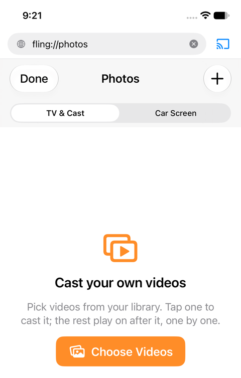

**From the phone's Photos tab** (the Photos shortcut on the start page): pick videos from your photo library and cast them to the car, or show photos. Formats the iPhone plays (MP4, MOV, HEVC) play as they are.

**From Files.** Import a file from the Files app. MKV, AVI and WebM are converted to MP4 on the phone before they play; a conversion can take a while for a long file.

**On the car's Photos tab**: Slideshow shows your photo album, or free photos if the album is empty, and the videos you imported are listed below. Add more on the phone under Photos, Car Screen.

---

## 10. Cast the phone's screen

Cast menu, **Cast Screen (Any App)** shows whatever is on the phone's screen on the car: any app, any page. iOS asks you to confirm the recording; tap Start Broadcast. To stop, come back to rPlayFling and tap the Cast button, or tap the red recording indicator at the top of the phone.

There is a delay of a second or more between the phone and the car; this is the nature of a screen cast. Protected video (Netflix, Disney+, Crunchyroll and other DRM apps) shows as a black picture with sound, because iOS blacks out protected video in any capture. Nothing can change that.

Settings, Mute phone while casting screen, tries to silence the phone during a screen cast; some phones ignore it, so the volume buttons are the sure way.

---

## 11. Casting to a TV

Everything in [Cast a web video to the car](#2-cast-a-web-video-to-the-car) works for a TV too. The difference is only what you pick in the Cast menu.

**What the Cast menu lists.** Besides Car Screen, the TVs and boxes on the same Wi-Fi as the phone:

- **Apple TV and AirPlay TVs** (Samsung, LG, Sony and others with AirPlay built in). The video goes to the TV as any AirPlay video does, and the remote bar on the phone controls it.
- **Chromecast and Google TV**, and TVs with Chromecast built in. Pick it under Chromecast in the menu; Switch Chromecast Device changes to another one.
- **DLNA TVs and boxes**, found automatically. One that is not found can be added by its address under Settings.

**The phone and the TV must be on the same Wi-Fi**, and iOS must allow Local Network for rPlayFling (see [Before you start](#1-before-you-start)). The car does not have this requirement.

**Quality** is the same as for the car: 1080p where the site offers it, as set under Cast Quality, with the same slow start at 360p on some videos.

**Sites that refuse to play on a TV.** Some sites allow their video to play only where it was opened. Settings, Route Video Through Phone, has the phone fetch the video and hand it to the TV, which gets round that at the cost of the phone's Wi-Fi bandwidth. On by default.

**Cast Screen** works to TVs as to the car, with the same delay and the same black picture for DRM apps. For a DLNA receiver, Settings, Low-latency screen cast, sends frames as they happen for the lowest delay; leave it off for TVs.

**Casting to a TV while in the car.** With Settings, CarPlay target only, on, the Cast menu offers only Car Screen and the TV settings are hidden. Turn it off to see TVs again.

---

## 12. Favorites, Recent and bookmarks

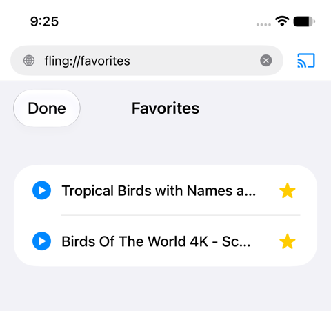

**Favorites** are videos. Tap the star on the remote bar while a video is casting, or beside a video under Recently Cast on the start page. Favorites are on the phone's start page and on the car's Favorites tab; tap one to cast it again. The car bar has a star too.

**Recent** is the list of what you cast, on the start page and on the car's Recent tab.

**Bookmarks** are pages. The ••• menu, Add to Bookmarks, puts the current page on the start page, and in the car Web tab's address field.

---

## 13. Settings, one by one

Open Settings from the ••• menu on the phone.

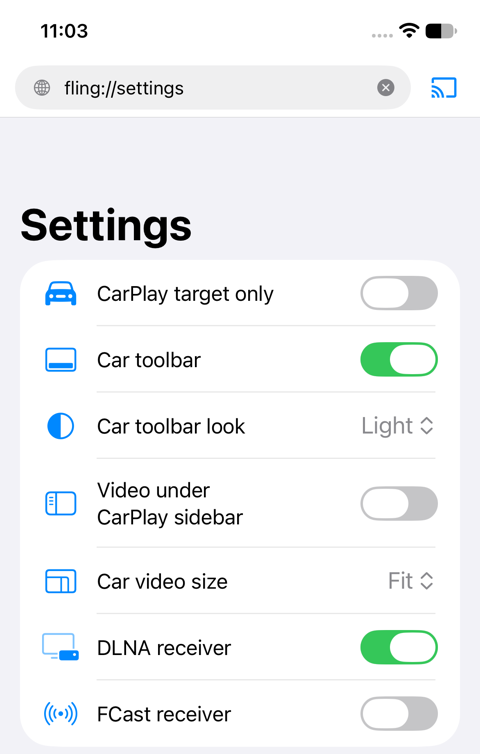 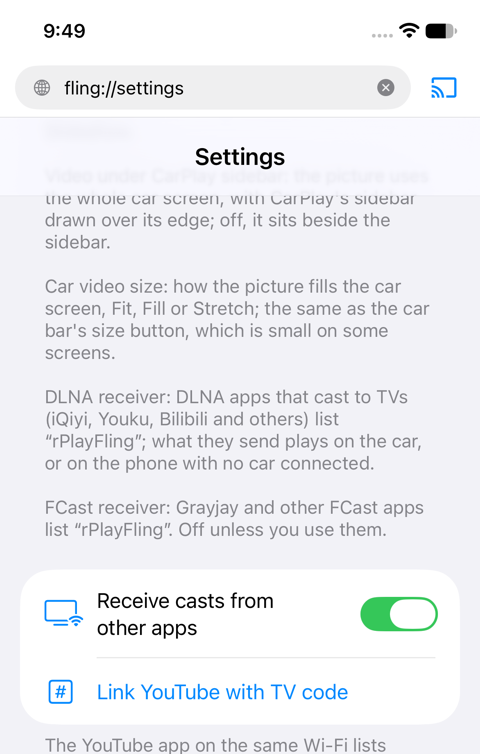 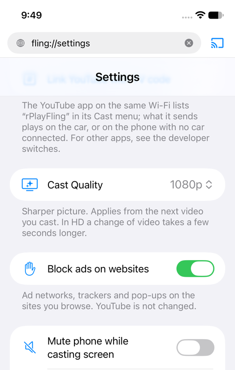 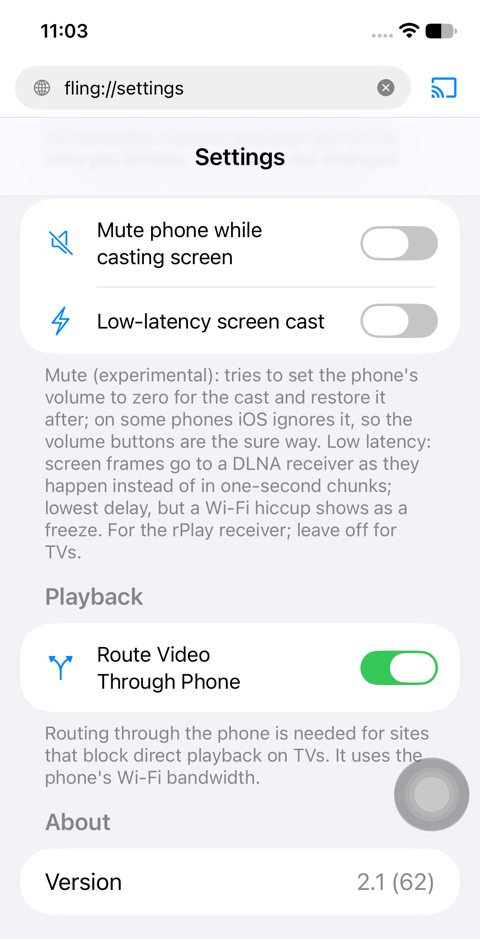

- **CarPlay target only.** For using rPlayFling with the car alone: the Cast menu offers just Car Screen, Photos opens the car's Photos and Slideshow, and the TV settings are hidden.
- **Car toolbar** and **Car toolbar look.** Whether the car's bottom bar shows, and its light or dark look.
- **Video under CarPlay sidebar.** The picture uses the whole car screen, with the sidebar over its edge.
- **Car video size.** Fit, Fill or Stretch, the same as the bar's size button.
- **Resume last video when the car connects.** Off by default. On, the video you cast last plays again from where it stopped as soon as rPlayFling is open on the car, from 2.1 (64).
- **DLNA receiver.** DLNA apps can cast to rPlayFling. On by default.
- **FCast receiver.** Grayjay and other FCast apps can cast to rPlayFling. Off by default.
- **Receive casts from other apps.** The YouTube app can find rPlayFling on the same Wi-Fi. On by default.
- **Link YouTube with TV code** and **Unlink YouTube TV code.** See [Cast from the YouTube app](#7-cast-from-the-youtube-app).
- **Cast Quality.** 1080p, 720p or 360p, from the next video you cast. Lower uses less data on cellular.
- **Block ads on websites.** Ad networks, trackers and pop-ups on the sites you browse. On by default. YouTube is not changed: its ads are YouTube's, and the cast follows the page through them.
- **Mute phone while casting screen** and **Low-latency screen cast.** For screen casts; low latency is for the rPlay receiver, leave it off for TVs.
- **Route Video Through Phone.** For TVs; see above.
- **About.** The version you are running, to quote in a bug report.

---

## 14. Driving

**The picture is hidden while the car moves**, and the sound keeps playing. rPlayFling goes by GPS speed; with no GPS answer, indoors or with Location not allowed, it goes by the driving limits the car itself reports. The picture comes back when the car stops. This is on by default and is what keeps rPlayFling in the App Store's good books.

**Lists while moving.** Some cars limit lists while the car moves; this is the car's own rule, not rPlayFling's, and it applies to every CarPlay app. Steering wheel next and previous still work, and so does the YouTube app as a remote.

---

## 15. Troubleshooting

**"Video isn't available on this car. Audio keeps playing."** The car's CarPlay cannot show rPlayFling's picture. On iOS 27.2 and later, CarPlay allows third-party video only through the car's own video playback feature, which only newer cars have; on such a car with iOS 27.2, rPlayFling plays the sound only. There is no way around this in the app.

**360p.** On the car, a video that stays at 360p for its whole length usually has no 16:9 HD version at the site, or the site held back HD for an ad slot longer than usual. On the phone page, 360p is YouTube's mobile page itself; the car gets HD regardless.

**The Cast menu finds no TV.** Allow Local Network for rPlayFling in iOS Settings, and check that the phone and the TV are on the same Wi-Fi. The car does not need Wi-Fi.

**The YouTube app does not list rPlayFling.** On cellular or on a car hotspot without internet, only the TV code entry can appear; link with a code. On Wi-Fi, open rPlayFling on the car first.

**The picture freezes or the sound stops.** Stop casting and cast again. On a weak cellular connection, set Cast Quality to 720p.

**No sound in the car.** Check that the car's source is CarPlay and the phone is not muted. For a screen cast, the sound comes with the screen.

**rPlayFling vanished from the car.** The phone was swiped away in the app switcher, or iOS ended it in the background. Open it again on the phone, then on the car.

**Battery.** Nothing runs in the background without a cast or a car. A long HD cast on cellular drains the battery as any video streaming does; a car charger solves it.

---

## 16. What rPlayFling cannot do

- Play protected (DRM) video: Netflix, Disney+, Crunchyroll, Apple TV+ and the like. iOS blacks out protected video in any cast or capture. This applies to every app of this kind.
- Show a picture on a car without CarPlay video support on iOS 27.2 and later (sound only).
- Keep playing after you swipe rPlayFling away in the app switcher.
- Show a video on the car while the car is moving.

---

## 17. Developer options

A hidden page holds the switches that are still experiments or that most people never need. To open it, type `fling://developer` in rPlayFling's address bar on the phone. Everything on it is off by default unless said otherwise, and nothing there is needed for normal use.

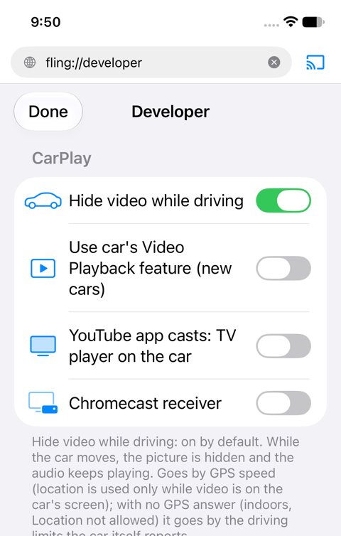 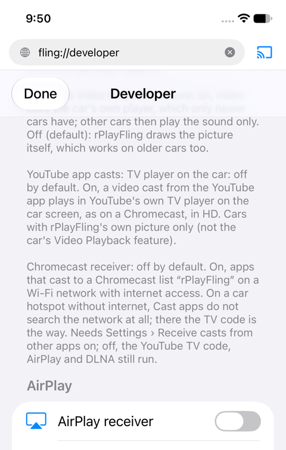 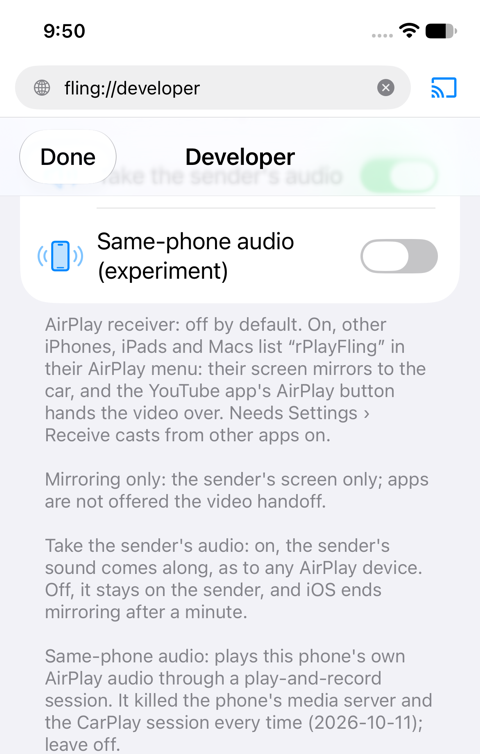 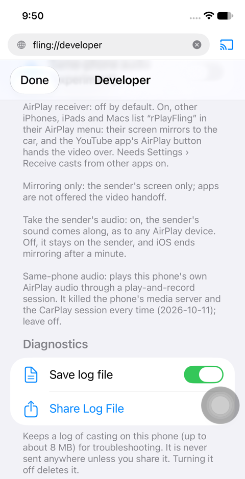

**CarPlay**

- **Hide video while driving.** On by default. Off, the picture stays on the car screen while the car moves. This is your responsibility and your passengers'; the law in most places says the driver may not watch.
- **Use car's Video Playback feature (new cars).** On, video goes through CarPlay's own video player, which only cars with that feature have (iOS 27.2 and later cars offer it); other cars then play the sound only. Off, rPlayFling draws the picture itself, which works on the cars most people have.
- **YouTube app casts: TV player on the car.** On, a video cast from the YouTube app plays in YouTube's own TV player on the car screen, as on a Chromecast, in HD, with YouTube's own look. Only on cars where rPlayFling draws the picture itself. Off, the video plays through rPlayFling's own player like any cast.
- **Chromecast receiver.** On, apps that cast to a Chromecast (YouTube, and many others) list "rPlayFling" on a Wi-Fi network that has internet access, and what they send plays on the car. On a car hotspot without internet, Cast apps do not search the network at all, so there the TV code is the way. Needs Settings, Receive casts from other apps, on.

**AirPlay**

- **AirPlay receiver.** On, other iPhones, iPads and Macs list "rPlayFling" in their AirPlay menu: their screen mirrors to the car, and the YouTube app's AirPlay button on those devices hands the video over to play on the car. Needs Settings, Receive casts from other apps, on. The phone that runs rPlayFling cannot AirPlay to itself with sound in the car; that is an iOS limit.
- **Mirroring only (no video handoff).** On, senders only mirror their screen; apps are not offered the video handoff.
- **Take the sender's audio.** On by default. On, the sender's sound comes along, as to any AirPlay device. Off, the sound stays on the sender, and iOS ends the mirroring after a minute.
- **Same-phone audio (experiment).** Leave it off. It tries to play this phone's own AirPlay audio through a recording session and it breaks the phone's audio and the CarPlay session every time.

**Diagnostics**

- **Save log file** and **Share Log File.** See the next section.

---

## 18. Sending a log with a bug report

A log tells us what happened on your phone; TestFlight feedback alone carries no log.

1. In rPlayFling's address bar, type `fling://developer` and open it.
2. Turn on **Save log file**.
3. Reproduce the problem.
4. Back on that page, tap **Share Log File** and send it to us, or attach it to an issue at https://github.com/rPlayAI/rPlayFling-public/issues.

The log stays on the phone until you share it, and turning Save log file off deletes it. It contains the addresses of the pages and streams you cast, so share it only with us.
